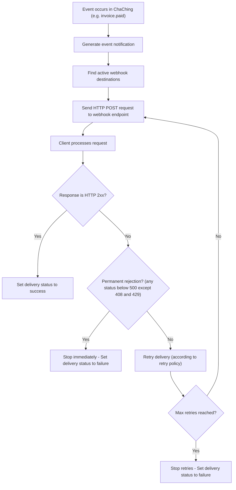

# Webhooks

ChaChing Webhooks allow your system to receive **real-time notifications** when events occur in your ChaChing account (e.g., customer updates, payments, subscriptions).

Webhooks are designed for clients using the **public API**, which allows them to react to system changes without polling.

---

# How Webhooks Work



1. An event occurs in ChaChing (e.g., customer details updated). For details related to the event types, refer to the section [Event Types](https://www.notion.so/Webhook-API-326dc7fc0a9280d087a1fe916d21c46c?pvs=21).
2. ChaChing generates an event notification.
3. ChaChing identifies all **active webhook endpoints** configured for the account.
4. ChaChing sends the event with its payload as an **HTTP POST request** to each webhook endpoint.
    Note: For payload details, refer to the **Event Structure** section.
5. Your system receives and processes the event.
6. Your endpoint must return an HTTP `2xx` response:
    - A `2xx` response sets the delivery status to `success`
    - A `5xx` response is retryable: the delivery status is `retry` while retries remain, and the delivery is retried according to the retry policy below
    - An HTTP `408` (Request Timeout) and an HTTP `429` (Too Many Requests) are also treated as retryable
    - No response at all — network failure, DNS failure, connection timeout, read timeout — is also treated as retryable
    - Any other non-`2xx` response is a **permanent rejection**: every `3xx` redirect and every `4xx` other than `408` and `429` (for example `400`, `401`, `403`, `404`, `410`). The delivery status is set to `failure` immediately and the delivery is never retried

---

# Retry Behavior

ChaChing automatically retries failed webhook deliveries.

Retries are triggered when:

- Network failure
- Timeout
- HTTP `5xx` response
- HTTP `408` (Request Timeout)
- HTTP `429` (Too Many Requests)

Retries are **not** triggered when the endpoint returns any other non-`2xx` status — every `3xx` redirect and every `4xx` other than `408` and `429`, for example `400`, `401`, `403`, `404` and `410`. Those statuses tell ChaChing the endpoint will never accept this payload, so the delivery status is set to `failure` after the first attempt and the returned status code is recorded in the delivery log.

**Retry Flow:**

- If a delivery fails with a retryable condition, the webhook is retried
- If **max retries NOT reached,** retry continues
- If **max retries reached,** the delivery status is set to `failure`
- If a delivery is **permanently rejected**, no retry is scheduled and the delivery status is set to `failure` right away

**Retry Policy:**

- Attempts: **5 retries** after the first delivery, for a maximum of 6 delivery attempts
- Retry window: **approximately 43 minutes** — the delays between attempts are approximately 15 seconds, 45 seconds, 2 minutes, 10 minutes and 30 minutes, each randomized by up to 20% in both directions

> ⚠️ Webhooks may be delivered multiple times. Ensure your system handles duplicates (use event `id`).
> 

---

# Key Concepts

## Webhooks are account-level

- Webhooks are configured **per account**
- Each account has its own webhook endpoints
- Events generated in one account are **not shared** with other accounts

---

## Multiple webhook endpoints

- You can create **multiple webhook endpoints**
- Events are sent to **all active endpoints within the account**

---

# Webhook Configuration

Webhooks can be managed via the **UI** (Settings → Developer → Webhooks) or programmatically via the **REST API**. Both approaches support the full lifecycle: create, list, update, enable/disable, and delete endpoints.

> In the UI, only users with the **Developer** or **SuperAdmin** role can manage webhooks. Through the REST API, the account's secret API key manages them. For user roles details, refer to the section Manage → Users in the left panel of the ChaChing application.

## Via the UI

1. In ChaChing, go to Settings → Developer settings.
2. In the Developer Settings, select the Webhooks tab to:
    - Create webhook endpoints
    - View all endpoints and the key that signs each one
    - Enable / disable endpoints
    - Rotate an endpoint's signing secret
    - Edit/Delete endpoints



### Creating a Webhook

1. Open **Developer Settings → Webhooks.**
2. Click **Create webhook.**



3. Enter endpoint URL and then select **Create endpoint**.

After creation:

- Webhook becomes **active**
- Events start being delivered immediately
- The endpoint's **signing secret** (`whsec_…`) is shown once, with a **Copy** button. Store it on your server: ChaChing never shows it again. If you lose it, rotate the secret.

### Rotating a Signing Secret

1. Open **Developer Settings → Webhooks.**
2. Click the key icon (**Rotate signing secret**) on the endpoint's row and confirm.
3. Copy the new signing secret. The dialog also shows until when the previous secret keeps working (24 hours).

The **Signing** column shows which key signs each endpoint: **Endpoint secret**, or **Account secret key** for an endpoint created before signing secrets existed that has never been rotated.

---

## Via the REST API

Manage webhook endpoints with the account **secret** API key (`sk_…`) in the `cc-api-key` header. A publishable key (`pk_…`) is refused with `403` and the error code `SECRET_API_KEY_REQUIRED`, and a request that also carries an `Authorization` header is refused with `409`. An account holds at most 16 endpoints.

### Endpoints

| Method | Path | Description |
|--------|------|-------------|
| `POST` | `/webhook-endpoints` | Create a webhook endpoint |
| `GET` | `/webhook-endpoints` | List the account's webhook endpoints, newest first |
| `GET` | `/webhook-endpoints/{id}` | Retrieve a webhook endpoint |
| `PUT` | `/webhook-endpoints/{id}` | Change the URL of a webhook endpoint |
| `DELETE` | `/webhook-endpoints/{id}` | Delete a webhook endpoint |
| `POST` | `/webhook-endpoints/{id}/enable` | Enable a webhook endpoint |
| `POST` | `/webhook-endpoints/{id}/disable` | Disable a webhook endpoint |
| `POST` | `/webhook-endpoints/{id}/rotate-secret` | Rotate the endpoint's signing secret |
| `GET` | `/webhook-endpoints/{id}/logs` | List the deliveries sent to a webhook endpoint |

### The Webhook Endpoint Object

```json
{
  "id": "0b6f7a52-3c1e-4d8a-9f43-2a7d1c5e8b90",
  "object": "webhook_endpoint",
  "endpoint": "https://your-server.com/webhook",
  "status": "active",
  "signature_key": "endpoint_secret",
  "created": 1761091200,
  "updated": 1761091200
}
```

`status` is `active` or `inactive`; events are sent only to `active` endpoints. `signature_key` says which key signs the deliveries: `endpoint_secret` (the endpoint's own signing secret) or `account_secret_key` (your account secret API key, for an endpoint created before signing secrets existed and never rotated). `created` and `updated` are Unix seconds. The signing secret itself is never part of this object: it appears only in the create and rotate responses.

### Create an Endpoint

```
POST /webhook-endpoints
```

**Request body:**

```json
{
  "endpoint": "https://your-server.com/webhook"
}
```

`endpoint` must be an `https` URL in production; an `http` URL is accepted only on non-production environments. A URL whose host is `localhost`, ends in `.local`, or is an IPv4 or IPv6 address in a private, loopback or link-local range is refused with `400`. The endpoint is created `active`, and the response is `201` with the Webhook Endpoint object. Creating a 17th endpoint answers `409` with the error code `WEBHOOK_ENDPOINTS_LIMIT_REACHED`. The create response also carries `secret`, the endpoint's signing secret (`whsec_…`). It is returned only in this response: store it on your server.

### List and Retrieve Endpoints

```
GET /webhook-endpoints
GET /webhook-endpoints/{id}
```

The list takes the page parameters `page` and `take` (`take` at most `50`) and answers `{ "data": [...], "meta": { "page": 1, "take": 10, "itemsTotal": 2, "pagesTotal": 1 } }`.

### Update an Endpoint

```
PUT /webhook-endpoints/{id}
```

The request body is the same `{ "endpoint": "..." }` object as the create. The endpoint keeps its `id` and its `status`.

### Enable / Disable an Endpoint

```
POST /webhook-endpoints/{id}/enable
POST /webhook-endpoints/{id}/disable
```

No request body. Enabling an `active` endpoint answers `400` with `WEBHOOK_ENDPOINT_ALREADY_ACTIVE`, and disabling an `inactive` endpoint answers `400` with `WEBHOOK_ENDPOINT_ALREADY_INACTIVE`.

### Delete an Endpoint

```
DELETE /webhook-endpoints/{id}
```

Deletes the endpoint permanently and answers `200` with the Webhook Endpoint object as it was before the deletion.

An `id` that is not one of your endpoints answers `404` with `WEBHOOK_ENDPOINT_NOT_FOUND`.

### Retrieve Delivery Logs

```
GET /webhook-endpoints/{id}/logs
```

Lists the deliveries sent to the endpoint's current URL, newest first, with the page parameters `page` and `take`. Filter by status with `search`, a URL-encoded JSON object: `{"status": "failure,retry"}`. `search` also accepts `pending`, but a pending delivery has no endpoint recorded yet, so the log never returns one. Each entry carries `id` (the `id` of the delivered event payload), `object` (`webhook_delivery`), `webhook_endpoint`, `event_type`, `status` (`success`, `retry` while another attempt is scheduled, or `failure`), `response_status_code` (the HTTP status your server answered, or `null` when no response arrived), `created` and `updated` (Unix seconds). A delivery appears in the log after its first attempt. Deliveries are matched by URL: after you change an endpoint's URL, its log lists the deliveries sent to the new URL.

### Rotate the Signing Secret

```
POST /webhook-endpoints/{id}/rotate-secret
```

No request body. Creates a new signing secret and answers `200` with the Webhook Endpoint object plus `secret` (the new `whsec_…` secret, returned only in this response) and `previous_secret_expires_at` (Unix seconds, 24 hours after the rotation):

```json
{
  "id": "0b6f7a52-3c1e-4d8a-9f43-2a7d1c5e8b90",
  "object": "webhook_endpoint",
  "endpoint": "https://your-server.com/webhook",
  "status": "active",
  "signature_key": "endpoint_secret",
  "created": 1761091200,
  "updated": 1761177600,
  "secret": "whsec_…",
  "previous_secret_expires_at": 1761264000
}
```

Until `previous_secret_expires_at`, every delivery carries two `v1` signatures: one for the new secret (first) and one for the previous secret. After it, only the new secret signs. At most two secrets are active: rotating again during those 24 hours ends the previous secret immediately, so rotating twice in a row revokes a secret you believe is compromised. An endpoint signed with your account secret key (`signature_key: account_secret_key`) gets its first signing secret on its first rotation, and your account secret key is the previous secret for those 24 hours. Rotating works on `active` and `inactive` endpoints; changing the URL, enabling and disabling keep the secret.

### Signing

Every delivery is signed as described in [Webhook Signatures](#webhook-signatures), with the endpoint's own signing secret. An endpoint created before signing secrets existed is signed with your account's secret API key until you rotate its secret for the first time.

---

# Event Types

ChaChing generates webhook events for key system entities. Each event represents a specific change or action performed in the system.

> Note: When you create a webhook you receive **ALL events without the ability to subscribe to a specific event type**.
> 

---

## Customer Events

- `customer.created` — A new customer is created
- `customer.updated` — An existing customer is updated
- `customer.deleted` — A customer is deleted

---

## Payment Method Events

- `payment_method.attached` — A payment method is attached to a customer, through the dashboard, the API or the customer portal. When the card is already saved for that customer, the event carries the saved payment method
- `payment_method.detached` — A payment method is detached from a customer

---

## Invoice Events

- `invoice.created` — A new invoice is created
- `invoice.deleted` — An invoice is deleted
- `invoice.finalized` — An invoice is finalized and ready for payment
- `invoice.sent` — An invoice is sent to the customer
- `invoice.payment_succeeded` — Invoice payment completed successfully
- `invoice.payment_failed` — Invoice payment failed

---

## Subscription Events

- `subscription.created` — A subscription is created
- `subscription.updated` — A subscription is updated
- `subscription.canceled` — A subscription is canceled
- `subscription.paused` — A subscription is paused
- `subscription.resumed` — A paused subscription is resumed

---

## Product Events

- `product.created` — A product is created
- `product.updated` — A product is updated
- `product.deleted` — A product is deleted

---

## Price Events

- `price.created` — A price is created
- `price.updated` — A price is updated
- `price.deleted` — A price is deleted

---

## Tax Events

- `tax.created` — A tax configuration is created
- `tax.updated` — A tax configuration is updated

---

## Payment Plan Events

- `payment_plan.created` — A payment plan is created
- `payment_plan.activated` — A payment plan starts running
- `payment_plan.installment_paid` — An installment of a payment plan is paid
- `payment_plan.installment_failed` — An automatic charge attempt on an installment is declined
- `payment_plan.past_due` — A payment plan changes to `past_due`
- `payment_plan.defaulted` — A payment plan changes to `defaulted`
- `payment_plan.reactivated` — A payment plan returns to `active` from `past_due` or `defaulted`
- `payment_plan.completed` — A payment plan is paid off
- `payment_plan.canceled` — A payment plan is canceled
- `payment_plan.payment_succeeded` — A payment is recorded on a payment plan

---

## Summary

ChaChing currently supports **34 webhook event types** across such entities as:

- Customers
- Payment Methods
- Invoices
- Subscriptions
- Products
- Prices
- Taxes
- Payment Plans

---

# Automatic Charges, Retries and Dunning

ChaChing generates webhook events for charges its billing engine initiates on its own — subscription renewals and their scheduled retries — in addition to charges started from the Dashboard, the hosted checkout page, and the REST API.

## Automatic Renewal Events

An automatic subscription renewal produces the following sequence of events:

1. `invoice.created` — the renewal invoice is created
2. `invoice.finalized` — the invoice is committed and ready for payment
3. `invoice.payment_succeeded` — the charge succeeds, **or** `invoice.payment_failed` — the charge is declined

---

## Retries and Failed-Payment Outcomes

A retry of an automatic charge that fails produces its own `invoice.payment_failed` event. The subscription events for the failed-payment outcomes configured in **Invoices & Subscriptions** settings are described in [Track subscription lifecycle and failed payments](./subscription-lifecycle.md). That page also documents the retry timeline, how the outcome day is counted, and when `next_payment_attempt` is present.

---

## Subscription Event Discriminators

`subscription.canceled`, `subscription.paused` and `subscription.resumed` carry two additional fields that distinguish who caused the transition:

- `reason` — `"dunning"` when the transition is driven by the billing engine, or `"requested"` when it is driven by an API call or a Dashboard action
- `initiated_by` — `"system"` for a dunning-driven transition, or `"merchant"` for an API- or Dashboard-driven one

Both fields are absent on `subscription.created` and `subscription.updated`.

---

## Deduplication

Every event is delivered at least once. Deduplicate on the envelope's `id` field, as described in [Important Notes for Integrators](#important-notes-for-integrators).

---

# Event Status

Webhook delivery has the following internal states:

- `pending` → waiting to be sent
- `retry` → retry in progress
- `success` → delivered successfully
- `failure` → the delivery was abandoned. Two situations produce it: the endpoint returned a **permanent rejection**, in which case no retry was attempted at all; and the endpoint kept failing with retryable conditions until every retry was exhausted. The response status code recorded on the delivery log entry tells the two apart

---

# Event Structure

All ChaChing webhook events share a **common envelope structure**, with the actual entity data contained inside the `data` field.

---

## Common Event Envelope

Every webhook sent by ChaChing follows this structure:

```json
{
  "id": "evt_123456",
  "account": {
    "id": "acc_3c1f0a9e2b7d4c58a1e6f204",
    "external_id": null,
    "company": {
      "id": "com_9d2e7b41c6a0f3e85b17d920",
      "external_id": null
    }
  },
  "created": 1773400500,
  "createdAt": "2026-03-13T11:15:00Z",
  "data": {
    // Entity-specific payload
  },
  "event": "customer.updated"
}
```

---

## Fields Description

- `id` — Unique event identifier. Use it to deduplicate: a retried delivery carries the same `id`
- `account` — The merchant account the event belongs to: `id` (`acc_…`), `external_id`, and its `company` with `id` (`com_…`) and `external_id`. `external_id` is `null` for every account today; reserved for platform accounts
- `created` — When the event was generated, in Unix seconds
- `createdAt` — The same instant as an ISO 8601 string. Deprecated: use `created`
- `data` — **Entity payload** (varies depending on event type)
- `event` — Event type (see Event Types section)

> ❗ Important: `data` already contains the object. There is **no `data.object` nesting**.
> 

---

## Customer Events Payload

Events:

- `customer.created`
- `customer.updated`
- `customer.deleted`

---

### Schema

```json
{
  "id": "cus_XXXXXXXX",
  "object": "customer",
  "name": "string",
  "email": "string | null",
  "external_id": "string | null",
  "description": "string | null",
  "phone": "string | null",
  "created": 1672531200,
  "currency": "string",
  "address": [
    {
      "city": "string",
      "country": "string",
      "line1": "string",
      "line2": "string",
      "postal_code": "string",
      "state": "string"
    }
  ],
  "shipping": {
    "name": "string",
    "phone": "string | null",
    "address": {
      "city": "string",
      "country": "string",
      "line1": "string",
      "line2": "string",
      "postal_code": "string",
      "state": "string"
    }
  }
}
```

`email` is `null` when the customer has no email address.

`external_id` is your own identifier for the customer, `null` when none was sent; see [External IDs](./payment-plans.md#external-ids).

---

### Example

```json
{
  "id": "evt_111",
  "account": {
    "id": "acc_3c1f0a9e2b7d4c58a1e6f204",
    "external_id": null,
    "company": {
      "id": "com_9d2e7b41c6a0f3e85b17d920",
      "external_id": null
    }
  },
  "created": 1773400500,
  "createdAt": "2026-03-13T11:15:00Z",
  "data": {
    "id": "cus_NffrFeUfNV2Hib",
    "object": "customer",
    "name": "John Doe",
    "email": "john.doe@example.com",
    "external_id": "PAT-799601",
    "description": "My First Test Customer",
    "phone": null,
    "created": 1680893993,
    "currency": "USD",
    "address": [
      {
        "city": "San Francisco",
        "country": "US",
        "line1": "123 Market St",
        "line2": "Apt 4B",
        "postal_code": "94103",
        "state": "CA"
      }
    ],
    "shipping": {
      "name": "John Doe",
      "phone": "+1 (555) 123-4567",
      "address": {
        "city": "San Francisco",
        "country": "US",
        "line1": "123 Market St",
        "line2": "Apt 4B",
        "postal_code": "94103",
        "state": "CA"
      }
    }
  },
  "event": "customer.created"
}
```

---

### Notes

- The `address` field is an **array of address objects**
- The `shipping.address` is a **single object** (not an array)
- The `phone` and `description` fields may be `null`
- Timestamps are in Unix format (seconds)

---

## Payment Method Events Payload

Events:

- `payment_method.attached`
- `payment_method.detached`

### Schema

```json
{
  "id": "pm_XXXXXXXX",
  "object": "payment_method",
  "allow_redisplay": "string",
  "billing_details": {
    "address": {
      "city": "string | null",
      "country": "string | null",
      "line1": "string | null",
      "line2": "string | null",
      "postal_code": "string | null",
      "state": "string | null"
    },
    "email": "string | null",
    "name": "string | null",
    "phone": "string | null"
  },
  "created": 1672531200,
  "customer": "cus_XXXXXXXX | null",
  "livemode": false,
  "metadata": {},
  "type": "string",
  "us_bank_account": {
    "account_holder_type": "individual | company",
    "account_type": "checking | savings",
    "bank_name": "string",
    "financial_connections_account": "string | null",
    "fingerprint": "string",
    "last4": "string",
    "networks": {
      "preferred": "string",
      "supported": ["string"]
    },
    "routing_number": "string",
    "status_details": {}
  }
}
```

### Example

```json
{
  "id": "evt_123",
  "account": {
    "id": "acc_3c1f0a9e2b7d4c58a1e6f204",
    "external_id": null,
    "company": {
      "id": "com_9d2e7b41c6a0f3e85b17d920",
      "external_id": null
    }
  },
  "created": 1773400500,
  "createdAt": "2026-03-13T11:15:00Z",
  "data": {
    "id": "pm_1Q0PsIJvEtkwdCNYMSaVuRz6",
    "object": "payment_method",
    "allow_redisplay": "unspecified",
    "billing_details": {
      "address": {
        "city": null,
        "country": null,
        "line1": null,
        "line2": null,
        "postal_code": null,
        "state": null
      },
      "email": null,
      "name": "John Doe",
      "phone": null
    },
    "created": 1726673582,
    "customer": null,
    "livemode": false,
    "metadata": {},
    "type": "us_bank_account",
    "us_bank_account": {
      "account_holder_type": "individual",
      "account_type": "checking",
      "bank_name": "STRIPE TEST BANK",
      "financial_connections_account": null,
      "fingerprint": "LstWJFsCK7P349Bg",
      "last4": "6789",
      "networks": {
        "preferred": "ach",
        "supported": [
          "ach"
        ]
      },
      "routing_number": "110000000",
      "status_details": {}
    }
  },
  "event": "payment_method.attached"
}
```

### Notes

- The `type` field defines the structure of the payment method (e.g., `card`, `us_bank_account`)
- The corresponding object (e.g., `us_bank_account`) is included based on the `type`
- Some fields may be `null` depending on the payment method and available data

---

## Invoice Events Payload

Events:

- `invoice.created`
- `invoice.deleted`
- `invoice.finalized`
- `invoice.sent`
- `invoice.payment_succeeded`
- `invoice.payment_failed`

### Schema

```json
{
  "id": "string",
  "object": "invoice",
  "account_country": "string",
  "account_name": "string",
  "amount_due": 0,
  "amount_paid": 0,
  "surcharge_amount": 0,
  "amount_charged": 0,
  "amount_remaining": 0,
  "attempt_count": 0,
  "next_payment_attempt": 1672531200,
  "attempted": true,
  "billing_reason": "string",
  "collection_method": "string",
  "created": 1672531200,
  "currency": "string",
  "customer": "cus_XXXXXXXX",
  "customer_external_id": "string | null",
  "customer_address": {
    "city": "string",
    "country": "string",
    "line1": "string",
    "line2": "string",
    "postal_code": "string",
    "state": "string"
  },
  "customer_email": "string",
  "customer_name": "string",
  "customer_phone": "string",
  "due_date": 1672531200,
  "failure_code": "string | null",
  "failure_message": "string | null",
  "hosted_invoice_url": "string | null",
  "lines": {
    "object": "list",
    "data": [],
    "total_count": 0
  },
  "number": "string",
  "paid": true,
  "period_end": 1672531200,
  "period_start": 1672531200,
  "status": "draft | open | paid | void",
  "status_transitions": {
    "finalized_at": 1672531200,
    "paid_at": 1672531200,
    "voided_at": 1672531200
  },
  "subscription": "sub_XXXXXXXX",
  "payment_plan": "pp_XXXXXXXX | null",
  "payment_plan_external_id": "string | null",
  "installment": "ppi_XXXXXXXX | null",
  "subtotal": 0,
  "subtotal_excluding_tax": 0,
  "tax": 0,
  "total": 0,
  "total_excluding_tax": 0,
  "total_taxes": [
    {
      "amount": 0,
      "tax_behavior": "inclusive | exclusive",
      "tax_rate": "txr_XXXXXXXX",
      "taxable_amount": 0
    }
  ]
}
```

`surcharge_amount` and `amount_charged` sum the invoice's successful payments, in cents: the credit card surcharge added to them and the total charged to the card. `amount_charged` equals `amount_paid` when no surcharge was added. Every credit card payment of an account that charges through iPOSpays (Dejavoo) can carry a surcharge, and debit card payments carry none; see [Credit Card Surcharges](./card-surcharges.md).

### Example

```json
{
  "id": "evt_456",
  "account": {
    "id": "acc_3c1f0a9e2b7d4c58a1e6f204",
    "external_id": null,
    "company": {
      "id": "com_9d2e7b41c6a0f3e85b17d920",
      "external_id": null
    }
  },
  "created": 1773400500,
  "createdAt": "2026-03-13T11:15:00Z",
  "data": {
    "id": "a80baa67-1341-4184-b712-b6f9b85b5a2b",
    "object": "invoice",
    "account_country": "US",
    "account_name": "Acme Corp",
    "amount_due": 1500,
    "amount_paid": 500,
    "surcharge_amount": 0,
    "amount_charged": 500,
    "amount_remaining": 1000,
    "attempt_count": 1,
    "next_payment_attempt": null,
    "attempted": true,
    "billing_reason": "subscription",
    "collection_method": "charge_automatically",
    "created": 1680645568,
    "currency": "USD",
    "customer": "cus_383fda0065594749023e8c8d",
    "customer_external_id": "PAT-799601",
    "customer_address": {
      "city": "San Francisco",
      "country": "US",
      "line1": "123 Market St",
      "line2": "Apt 4B",
      "postal_code": "94103",
      "state": "CA"
    },
    "customer_email": "john.doe@example.com",
    "customer_name": "John Doe",
    "customer_phone": "+1234567890",
    "due_date": 1680645568,
    "failure_code": null,
    "failure_message": null,
    "hosted_invoice_url": "https://acme.pay.example.com/checkout/a80baa67-1341-4184-b712-b6f9b85b5a2b",
    "lines": {
      "object": "list",
      "data": [],
      "total_count": 0
    },
    "number": "INV-1001",
    "paid": true,
    "period_end": 1680645568,
    "period_start": 1680645568,
    "status": "paid",
    "status_transitions": {
      "finalized_at": 1680645568,
      "paid_at": 1680645568,
      "voided_at": 1680645568
    },
    "subscription": "sub_Wm45f5PGQvv67azFeH1z7PO3",
    "subtotal": 1500,
    "subtotal_excluding_tax": 1500,
    "tax": 150,
    "total": 1650,
    "total_excluding_tax": 1500,
    "total_taxes": [
      {
        "amount": 150,
        "tax_behavior": "exclusive",
        "tax_rate": "txr_1S2tlWDZYOQH9uHkltYEi1ap",
        "taxable_amount": 1500
      }
    ]
  },
  "event": "invoice.payment_succeeded"
}
```

### Notes

- The `status` field reflects the current lifecycle state of the invoice
- `status_transitions` shows timestamps for key lifecycle changes
- Monetary values are represented in the smallest currency unit (e.g., cents)
- The `lines` field contains invoice line items (structure may vary)
- Some fields may be `null` depending on invoice state and configuration
- `attempt_count` is present on every invoice event. `next_payment_attempt` is present only on `invoice.payment_succeeded` and `invoice.payment_failed` for an automatic charge; see [Track subscription lifecycle and failed payments](./subscription-lifecycle.md) for when it is present and what `null` means
- `invoice.payment_succeeded` for a payment made through ChaChing (the dashboard, the payment page or an API request that pays the invoice) describes the invoice after that payment: its `amount_paid`, `surcharge_amount`, `amount_charged`, `status` and `attempt_count` include it
- `next_payment_attempt` is a Unix timestamp in seconds, matching every other timestamp in this payload
- `payment_plan`, `installment` and `payment_plan_charge` name the payment plan, the installment and the plan charge an invoice was raised for. All three are `null` on an invoice that belongs to no payment plan, and an invoice raised for a payment plan reports `subscription: null`. `payment_plan_charge` is `{ id, installment, sequence, payment, kind }`, with `kind` one of `down_payment`, `deposit`, `installment`, `extra_payment`, `payoff`. See [Payment Plans](./payment-plans.md). `payment_plan_external_id` is the plan's `external_id`, `null` when the invoice belongs to no plan or the plan has none.
- `due_date` is the invoice due date in Unix seconds. `hosted_invoice_url` is the permanent link to the invoice's payment page, the same URL `GET /invoices/{id}/hosted-link` returns. `failure_code` and `failure_message` describe the decline of the invoice's most recent payment attempt, and are `null` when that attempt was not declined or the invoice has no payment attempt

---

## Subscription Events Payload

Events:

- `subscription.created`
- `subscription.updated`
- `subscription.canceled`
- `subscription.paused`
- `subscription.resumed`

---

### Schema

```json
{
  "id": "sub_XXXXXXXX",
  "object": "subscription",
  "billing_cycle_anchor": 1672531200,
  "cancel_at": 1672531200,
  "cancel_at_period_end": false,
  "canceled_at": 1672531200,
  "collection_method": "string",
  "created": 1672531200,
  "currency": "string",
  "customer": "cus_XXXXXXXX",
  "reason": "dunning | requested",
  "initiated_by": "system | merchant",
  "ended_at": 1672531200,
  "items": {
    "object": "list",
    "data": [
      []
    ],
    "total_count": 0
  },
  "latest_invoice": "string",
  "start_date": 1672531200,
  "status": "active | trial | scheduled | paused | unpaid | cancelled | expired",
  "trial_end": 1672531200,
  "trial_start": 1672531200
}
```

---

### Example

```json
{
  "id": "evt_789",
  "account": {
    "id": "acc_3c1f0a9e2b7d4c58a1e6f204",
    "external_id": null,
    "company": {
      "id": "com_9d2e7b41c6a0f3e85b17d920",
      "external_id": null
    }
  },
  "created": 1773400500,
  "createdAt": "2026-03-13T11:15:00Z",
  "data": {
    "id": "sub_2FdhgypnsJQn9mZlY5qGaElL",
    "object": "subscription",
    "billing_cycle_anchor": 1679609767,
    "cancel_at": null,
    "cancel_at_period_end": false,
    "canceled_at": null,
    "collection_method": "charge_automatically",
    "created": 1679609767,
    "currency": "USD",
    "customer": "cus_739c07713fd4b68565a969cd",
    "ended_at": null,
    "items": {
      "object": "list",
      "data": [
        []
      ],
      "total_count": 1
    },
    "latest_invoice": "58d0f1c9-ca00-4998-8e89-d74a290b4df6",
    "start_date": 1679609767,
    "status": "active",
    "trial_end": null,
    "trial_start": null
  },
  "event": "subscription.created"
}
```

The following example shows a `subscription.canceled` event driven by the billing engine's dunning process, carrying `reason` and `initiated_by`:

```json
{
  "id": "evt_790",
  "account": {
    "id": "acc_3c1f0a9e2b7d4c58a1e6f204",
    "external_id": null,
    "company": {
      "id": "com_9d2e7b41c6a0f3e85b17d920",
      "external_id": null
    }
  },
  "created": 1773400500,
  "createdAt": "2026-03-13T11:15:00Z",
  "data": {
    "id": "sub_2FdhgypnsJQn9mZlY5qGaElL",
    "object": "subscription",
    "billing_cycle_anchor": 1679609767,
    "cancel_at": 1680645568,
    "cancel_at_period_end": false,
    "canceled_at": 1680645568,
    "collection_method": "charge_automatically",
    "created": 1679609767,
    "currency": "USD",
    "customer": "cus_739c07713fd4b68565a969cd",
    "reason": "dunning",
    "initiated_by": "system",
    "ended_at": 1680645568,
    "items": {
      "object": "list",
      "data": [
        []
      ],
      "total_count": 1
    },
    "latest_invoice": "58d0f1c9-ca00-4998-8e89-d74a290b4df6",
    "start_date": 1679609767,
    "status": "cancelled",
    "trial_end": null,
    "trial_start": null
  },
  "event": "subscription.canceled"
}
```

---

### Notes

- The `status` field is one of `active`, `trial`, `scheduled`, `paused`, `unpaid`, `cancelled`, or `expired`; see [Track subscription lifecycle and failed payments](./subscription-lifecycle.md). The event name `subscription.canceled` is spelled with one `l`, and the status value `cancelled` with two
- Fields like `cancel_at`, `canceled_at`, and `ended_at` may be `null` depending on lifecycle state
- `items.data` contains subscription items (structure depends on pricing configuration)
- `latest_invoice` links the most recent invoice associated with the subscription
- Timestamps are in Unix format (seconds)
- `reason` and `initiated_by` are present on `subscription.canceled`, `subscription.paused` and `subscription.resumed`, and absent on `subscription.created` and `subscription.updated`
- The two fields always travel together: `"dunning"` is always paired with `"system"`, and `"requested"` is always paired with `"merchant"`
- `items.data[].price.type` is `one_time`, `recurring` or `null`: it is `null` for an item whose price cannot be resolved. Handle `null` wherever you branch on the price type

---

## Product Events Payload

Events:

- `product.created`
- `product.updated`
- `product.deleted`

### Schema

```json
{
  "id": "prod_XXXXXXXX",
  "object": "product",
  "active": true,
  "created": 1672531200,
  "default_price": "price_XXXXXXXX",
  "description": "string | null",
  "name": "string",
  "tax_code": "string",
  "updated": 1672531200
}
```

### Example

```json
{
  "id": "evt_321",
  "account": {
    "id": "acc_3c1f0a9e2b7d4c58a1e6f204",
    "external_id": null,
    "company": {
      "id": "com_9d2e7b41c6a0f3e85b17d920",
      "external_id": null
    }
  },
  "created": 1773400500,
  "createdAt": "2026-03-13T11:15:00Z",
  "data": {
    "id": "prod_xT4LfvxLMQb4s9uFNIbXf9pm",
    "object": "product",
    "active": true,
    "created": 1760018761,
    "default_price": "price_1SGKTmDZYOQH9uHk1vaSxPKa",
    "description": null,
    "name": "Gold Plan",
    "tax_code": "txcd_10000000",
    "updated": 1753181495
  },
  "event": "product.updated"
}
```

### Notes

- The `default_price` field references the default price associated with the product
- The `description` field may be `null` if not provided
- The `active` field indicates whether the product is available for use
- Timestamps are in Unix format (seconds)

---

## Price Events Payload

Events:

- `price.created`
- `price.updated`
- `price.deleted`

### Schema

```json
{
  "id": "price_XXXXXXXX",
  "object": "price",
  "active": true,
  "created": 1672531200,
  "currency": "string",
  "description": "string | null",
  "product": "prod_XXXXXXXX | null",
  "recurring": {
    "interval": "day | week | month | year",
    "interval_count": 1
  } | null,
  "tax_behavior": "inclusive | exclusive",
  "type": "one_time | recurring",
  "unit_amount": 0,
  "unit_amount_decimal": "string",
  "link": "string"
}
```

### Example

```json
{
  "id": "evt_654",
  "account": {
    "id": "acc_3c1f0a9e2b7d4c58a1e6f204",
    "external_id": null,
    "company": {
      "id": "com_9d2e7b41c6a0f3e85b17d920",
      "external_id": null
    }
  },
  "created": 1773400500,
  "createdAt": "2026-03-13T11:15:00Z",
  "data": {
    "id": "price_1SGKTmDZYOQH9uHk1vaSxPKa",
    "object": "price",
    "active": true,
    "created": 1760018761,
    "currency": "USD",
    "description": "Premium Plan - Monthly",
    "product": null,
    "recurring": null,
    "tax_behavior": "exclusive",
    "type": "one_time",
    "unit_amount": 1000,
    "unit_amount_decimal": "1000",
    "link": "string"
  },
  "event": "price.created"
}
```

---

### Notes

- The `type` field defines whether the price is **one-time** or **recurring**
- The `recurring` object is `null` when `type` is `one_time`, and a `{ interval, interval_count }` object when `type` is `recurring`.
- `unit_amount` is represented in the smallest currency unit (e.g., cents)
- `product` may be `null` if not linked
- `unit_amount_decimal` provides a precise representation of the amount
- `tax_behavior` defines how taxes are applied (inclusive or exclusive)

---

## Tax Events Payload

Events:

- `tax.created`
- `tax.updated`

### Schema

```json
{
  "id": "txr_XXXXXXXX",
  "object": "tax_rate",
  "active": true,
  "country": "string",
  "created": 1672531200,
  "description": "string | null",
  "display_name": "string",
  "inclusive": true,
  "percentage": 0,
  "tax_type": "string"
}
```

### Example

```json
{
  "id": "evt_987",
  "account": {
    "id": "acc_3c1f0a9e2b7d4c58a1e6f204",
    "external_id": null,
    "company": {
      "id": "com_9d2e7b41c6a0f3e85b17d920",
      "external_id": null
    }
  },
  "created": 1773400500,
  "createdAt": "2026-03-13T11:15:00Z",
  "data": {
    "id": "txr_inQ4hbLZPyljDXFRCEnjtEqK",
    "object": "tax_rate",
    "active": true,
    "country": "US",
    "created": 1678833149,
    "description": "State sales tax",
    "display_name": "Sales Tax",
    "inclusive": true,
    "percentage": 7.25,
    "tax_type": "Custom"
  },
  "event": "tax.created"
}
```

---

### Notes

- The `percentage` field represents the tax rate (e.g., `7.25` = 7.25%)
- The `inclusive` field indicates whether the tax is included in the price
- `tax_type` defines the type of tax configuration (e.g., custom)
- The `description` field may be `null` depending on configuration

---

## Payment Plan Events Payload

Events:

- `payment_plan.created`
- `payment_plan.activated`
- `payment_plan.past_due`
- `payment_plan.defaulted`
- `payment_plan.reactivated`
- `payment_plan.completed`
- `payment_plan.canceled`

carry the Payment Plan object.

- `payment_plan.installment_paid`
- `payment_plan.installment_failed`

carry the Installment object.

- `payment_plan.payment_succeeded`

carries the Payment object.

---

### Schema — Payment Plan

```json
{
  "id": "pp_XXXXXXXX",
  "object": "payment_plan",
  "external_id": "string | null",
  "customer": "cus_XXXXXXXX",
  "customer_external_id": "string | null",
  "description": "string | null",
  "status": "awaiting_deposit | active | past_due | defaulted | paid_off | canceled",
  "currency": "string",
  "total_amount": 0,
  "down_payment_amount": 0,
  "installment_amount": 0,
  "installment_count": 0,
  "interval": "daily | weekly | biweekly | monthly | annual",
  "start_date": 1672531200,
  "remainder_placement": "first | last",
  "remaining_balance": 0,
  "installments_paid": 0,
  "installments_remaining": 0,
  "next_due_date": "1672531200 | null",
  "payment_method": "string | null",
  "gateway": "string | null",
  "reference": "string | null",
  "deposit": {
    "reference": "string",
    "kind": "down_payment | installment_1",
    "amount": 0,
    "status": "pending | collected",
    "transaction_reference": "string | null",
    "collected_at": "1672531200 | null",
    "attempt": {
      "id": "ppda_XXXXXXXX",
      "object": "payment_plan_deposit_attempt",
      "terminal": "string",
      "reference_id": "string",
      "state": "in_flight | resolving | approved | approved_no_credential | declined | cancelled | not_charged | failed | partial_approval | force_closed",
      "started": 1672531200,
      "resolved": "1672531200 | null",
      "decline_code": "string | null",
      "decline_message": "string | null",
      "surcharge_amount": 0,
      "amount_charged": 0
    }
  },
  "created": 1672531200,
  "ended_at": "1672531200 | null",
  "canceled_at": "1672531200 | null"
}
```

### Schema — Installment

```json
{
  "id": "ppi_XXXXXXXX",
  "object": "payment_plan_installment",
  "payment_plan": "pp_XXXXXXXX",
  "payment_plan_external_id": "string | null",
  "customer": "cus_XXXXXXXX",
  "customer_external_id": "string | null",
  "sequence": 0,
  "due_date": 1672531200,
  "amount": 0,
  "amount_paid": 0,
  "surcharge_amount": 0,
  "amount_charged": 0,
  "surcharge_status": "final | unavailable",
  "status": "scheduled | paid | failed | canceled",
  "attempt_count": 0,
  "next_payment_attempt": "1672531200 | null",
  "paid_at": "1672531200 | null",
  "first_failed_at": "1672531200 | null",
  "failure_code": "string | null",
  "failure_message": "string | null",
  "card": "object | null",
  "invoice": "string | null",
  "hosted_invoice_url": "string | null",
  "payment_plan_summary": "object"
}
```

### Schema — Payment

```json
{
  "id": "ppp_XXXXXXXX",
  "object": "payment_plan_payment",
  "payment_plan": "pp_XXXXXXXX",
  "payment_plan_external_id": "string | null",
  "customer": "cus_XXXXXXXX",
  "customer_external_id": "string | null",
  "status": "processing | applied | partially_applied",
  "amount": 0,
  "surcharge_amount": 0,
  "amount_charged": 0,
  "surcharge_status": "final | unavailable",
  "external": false,
  "payment_method": "string | null",
  "card": "object | null",
  "invoice": "string | null",
  "hosted_invoice_url": "string | null",
  "payoff": false,
  "created": 1672531200,
  "payment_plan_status": "awaiting_deposit | active | past_due | defaulted | paid_off | canceled",
  "remaining_balance": 0,
  "installments_remaining": 0,
  "allocations": "array",
  "payment_plan_summary": "object",
  "terminal": "object | null"
}
```

The `terminal` object the event emits carries all 17 keys of the terminal object described in [Take a Payment on a Terminal](./payment-plans.md#take-a-payment-on-a-terminal), and its `state` is `approved` or `partial_approval` at emission.

`card` is `{ "brand": "string | null", "last4": "string | null" }`, or `null` when the card cannot be read. `card.brand` is the gateway's card network label as stored; it is not guaranteed to be lowercase, so compare it case-insensitively.

`first_failed_at` is the time ChaChing recorded the first confirmed decline of the installment, in Unix seconds. It is `null` for an installment whose only declines predate this field, and it does not change on later retries.

### Schema — Payment Allocation

`allocations` lists the installment and principal amounts a payment paid, in the order they were applied. It is `[]` for a payment whose `status` is not `applied` or `partially_applied`.

```json
{
  "installment": "ppi_XXXXXXXX | null",
  "sequence": "0 | null",
  "kind": "installment | principal",
  "amount": 0,
  "surcharge_amount": 0,
  "amount_charged": 0,
  "surcharge_status": "final | unavailable",
  "invoice": "string | null",
  "hosted_invoice_url": "string | null"
}
```

### Schema — Plan Summary

`payment_plan_summary` carries the same values as the same-named keys of the Payment Plan object.

```json
{
  "installment_count": 0,
  "currency": "string",
  "description": "string | null",
  "remaining_balance": 0,
  "installments_paid": 0,
  "installments_remaining": 0,
  "next_due_date": "1672531200 | null",
  "status": "awaiting_deposit | active | past_due | defaulted | paid_off | canceled"
}
```

### Example

`payment_plan.installment_failed`, with a retry scheduled:

```json
{
  "id": "evt_9f2a7c41",
  "account": {
    "id": "acc_3c1f0a9e2b7d4c58a1e6f204",
    "external_id": null,
    "company": {
      "id": "com_9d2e7b41c6a0f3e85b17d920",
      "external_id": null
    }
  },
  "created": 1763110812,
  "createdAt": "2025-11-14T09:00:12Z",
  "data": {
    "id": "ppi_Mc8yS3Rb",
    "object": "payment_plan_installment",
    "payment_plan": "pp_8QN4mTcRk2VwZfLp",
    "payment_plan_external_id": "PLAN-2026-0117",
    "customer": "cus_739c07713fd4b68565a969cd",
    "customer_external_id": "PAT-799601",
    "sequence": 2,
    "due_date": 1763078400,
    "amount": 20000,
    "amount_paid": 0,
    "surcharge_amount": 0,
    "amount_charged": 0,
    "surcharge_status": "final",
    "status": "failed",
    "attempt_count": 1,
    "next_payment_attempt": 1763164800,
    "paid_at": null,
    "first_failed_at": 1763078412,
    "failure_code": "05",
    "failure_message": "Do Not Honor",
    "card": {
      "brand": "visa",
      "last4": "4242"
    },
    "invoice": "c1f0d9aa-2b44-4d19-9d02-77b2aa4e1c30",
    "hosted_invoice_url": "https://acme.pay.example.com/checkout/c1f0d9aa-2b44-4d19-9d02-77b2aa4e1c30",
    "payment_plan_summary": {
      "installment_count": 9,
      "currency": "USD",
      "description": "Orthodontic treatment, upper and lower braces",
      "remaining_balance": 160000,
      "installments_paid": 1,
      "installments_remaining": 8,
      "next_due_date": 1763078400,
      "status": "past_due"
    }
  },
  "event": "payment_plan.installment_failed"
}
```

`payment_plan.completed`:

```json
{
  "id": "evt_d41c07ab",
  "account": {
    "id": "acc_3c1f0a9e2b7d4c58a1e6f204",
    "external_id": null,
    "company": {
      "id": "com_9d2e7b41c6a0f3e85b17d920",
      "external_id": null
    }
  },
  "created": 1781395651,
  "createdAt": "2026-06-14T00:07:31Z",
  "data": {
    "id": "pp_8QN4mTcRk2VwZfLp",
    "object": "payment_plan",
    "external_id": "PLAN-2026-0117",
    "customer": "cus_739c07713fd4b68565a969cd",
    "customer_external_id": "PAT-799601",
    "description": "Orthodontic treatment, upper and lower braces",
    "status": "paid_off",
    "currency": "USD",
    "total_amount": 210000,
    "down_payment_amount": 30000,
    "installment_amount": 20000,
    "installment_count": 9,
    "interval": "monthly",
    "start_date": 1760400000,
    "remainder_placement": "first",
    "remaining_balance": 0,
    "installments_paid": 9,
    "installments_remaining": 0,
    "next_due_date": null,
    "payment_method": "9f3a1c2e-7b45-4d18-a6c0-2f8e5b7d1a94",
    "gateway": "dejavoo",
    "reference": null,
    "deposit": null,
    "created": 1757894400,
    "ended_at": 1781395651,
    "canceled_at": null
  },
  "event": "payment_plan.completed"
}
```

`payment_plan.payment_succeeded` for a payment that reached the principal:

```json
{
  "id": "evt_5b0e93f2",
  "account": {
    "id": "acc_3c1f0a9e2b7d4c58a1e6f204",
    "external_id": null,
    "company": {
      "id": "com_9d2e7b41c6a0f3e85b17d920",
      "external_id": null
    }
  },
  "created": 1763483200,
  "createdAt": "2025-11-18T16:26:40Z",
  "data": {
    "id": "ppp_4Hk9Tz2W",
    "object": "payment_plan_payment",
    "payment_plan": "pp_8QN4mTcRk2VwZfLp",
    "payment_plan_external_id": "PLAN-2026-0117",
    "customer": "cus_739c07713fd4b68565a969cd",
    "customer_external_id": "PAT-799601",
    "status": "applied",
    "amount": 50000,
    "surcharge_amount": 0,
    "amount_charged": 50000,
    "surcharge_status": "final",
    "external": false,
    "payment_method": "9f3a1c2e-7b45-4d18-a6c0-2f8e5b7d1a94",
    "card": {
      "brand": "visa",
      "last4": "4242"
    },
    "invoice": "d5b9e2c1-8a41-4f36-9c17-3ad0b1e5f882",
    "hosted_invoice_url": "https://acme.pay.example.com/checkout/d5b9e2c1-8a41-4f36-9c17-3ad0b1e5f882",
    "payoff": false,
    "created": 1763483200,
    "payment_plan_status": "active",
    "remaining_balance": 130000,
    "installments_remaining": 7,
    "allocations": [
      {
        "installment": "ppi_Mc8yS3Rb",
        "sequence": 2,
        "kind": "installment",
        "amount": 20000,
        "surcharge_amount": 0,
        "amount_charged": 20000,
        "surcharge_status": "final",
        "invoice": "c1f0d9aa-2b44-4d19-9d02-77b2aa4e1c30",
        "hosted_invoice_url": "https://acme.pay.example.com/checkout/c1f0d9aa-2b44-4d19-9d02-77b2aa4e1c30"
      },
      {
        "installment": null,
        "sequence": null,
        "kind": "principal",
        "amount": 30000,
        "surcharge_amount": 0,
        "amount_charged": 30000,
        "surcharge_status": "final",
        "invoice": "d5b9e2c1-8a41-4f36-9c17-3ad0b1e5f882",
        "hosted_invoice_url": "https://acme.pay.example.com/checkout/d5b9e2c1-8a41-4f36-9c17-3ad0b1e5f882"
      }
    ],
    "payment_plan_summary": {
      "installment_count": 9,
      "currency": "USD",
      "description": "Orthodontic treatment, upper and lower braces",
      "remaining_balance": 130000,
      "installments_paid": 2,
      "installments_remaining": 7,
      "next_due_date": 1765670400,
      "status": "active"
    },
    "terminal": null
  },
  "event": "payment_plan.payment_succeeded"
}
```

---

### Notes

- The Payment Plan object in `data` is the plan after the change, and its `status` is the plan's status when the event is sent. A plan created with a payment method sends `payment_plan.created` and `payment_plan.activated` with the same object, `status: "active"`
- `payment_plan.installment_failed` is sent once per declined automatic charge attempt, retries included. A declined payment through `POST /payment-plans/{id}/payments` answers the request with an error instead and sends no `payment_plan.installment_failed`. `attempt_count` counts the attempts made on the installment, and `next_payment_attempt` is the date of the next retry, or `null` when no retry is scheduled
- `payment_plan.installment_paid` is sent once per installment. The down payment sends it with `sequence: 0`, both when it is charged at creation and when it is collected on a terminal
- `deposit` is `null` for a plan created with a payment method. For a plan created without one, `deposit.kind` is `down_payment` when the plan has a down payment and `installment_1` otherwise, `deposit.amount` is the amount the terminal collects, and `deposit.attempt` is `null` until the first terminal attempt and then holds the latest attempt; see [Collect the First Installment on a Terminal](./payment-plans.md#collect-the-first-installment-on-a-terminal)
- `payment_plan.completed` is the single paid-in-full event. It is sent when the schedule ends with every installment paid, when a payoff payment is recorded, and when the last unpaid installment is paid through the hosted invoice page, the dashboard or `PUT /invoices/{id}` or settled by credit; `status` is `paid_off` in every case
- `payment_plan.payment_succeeded` is sent for every payment `POST /payment-plans/{id}/payments` records — installment payments, principal payments, payoffs and external payments alike — and never for a declined or refused one. Its `data` is the Payment object at the moment the payment is recorded: `id`, `amount`, `external`, `payment_method`, `invoice` and `payoff` match the endpoint's response (except for a payment taken on a terminal, whose `201` is `processing` with `amount` `0`: the event carries the final values), while for a payment that reached the principal, the event is sent after the plan's remaining schedule is rebuilt, and `remaining_balance`, `installments_remaining`, `payment_plan_status` and `payment_plan_summary` describe the plan after it. A repeated request with the same `Idempotency-Key` sends nothing again. When a request ends before its payment is fully recorded, ChaChing finishes recording it later and sends the payment's events then. For one payment they are sent in this order: `payment_plan.installment_paid`, then `payment_plan.payment_succeeded`, then `payment_plan.completed`; a delivery that is retried can arrive after a later event. This event is sent only with `status` `applied` or `partially_applied`.
- `surcharge_amount` and `amount_charged` on the Installment and Payment objects report the credit card surcharge and the total charged to the card, in cents. While ChaChing cannot read the surcharge from the gateway yet, they read `0` and the amount paid, and `payment_plan.installment_paid` and `payment_plan.payment_succeeded` wait until the surcharge is read, for up to an hour; after an hour they are sent with `surcharge_status` `unavailable`. When ChaChing cannot read the surcharge of a charge (after retrying for up to 7 days, or at once when the charge cannot be matched), the objects keep `surcharge_amount` at `0` and `amount_charged` equal to the amount paid, and that does not change later; the exact amount charged to the card is then the one shown for that transaction in your Dejavoo (iPOSpays) account. See [Credit Card Surcharges](./payment-plans.md#credit-card-surcharges)
- The principal part of a payment has its own invoice: when the principal is recorded, ChaChing sends `invoice.payment_succeeded` for it (and `invoice.payment_failed` when its card charge is declined), with `payment_plan_charge.kind` `extra_payment` or `payoff`. `payment_plan.payment_succeeded` reports the same money, so count each payment once. A principal recorded without an invoice (account credit, automatic or manual payment switched off, invoicing unavailable) raises no `invoice.*` event.
- `terminal` on the Payment object is `null` for a payment that was not taken on a terminal. For a payment taken on a terminal it holds the sale, and `payment_plan.payment_succeeded` is sent when ChaChing records it after the terminal approved it; see [Take a Payment on a Terminal](./payment-plans.md#take-a-payment-on-a-terminal)
- The plan status `past_due` means the customer's account is in the late-payment warning. It is not the `past-due` failed-payment outcome: reaching that outcome sends `payment_plan.defaulted`
- The `invoice.*` events keep firing for every installment invoice; the invoice payload's `payment_plan` and `installment` fields link it back to the plan
- The spelling is `canceled`, with one `l`, for both the status and the event
- One change can send several events, and deliveries can arrive in any order. Read the plan with `GET /payment-plans/{id}` for its current state; see [Payment Plans](./payment-plans.md)
- To send your own receipts and notices from these events, see [Send Your Own Customer Notifications](./customer-notifications.md)

---

# Important Notes

The data object is contained inside the `data` field.

- The `data` field contains the **full entity object**

---

Deleted events

- May contain limited data (e.g., only `id`)
- Should not be assumed to contain full object

---

Always rely on `event`

- Use `event` field to determine how to parse `data`

---

# Payload Behavior

- The payload reflects the **entity after change**
- Example:
    - Customer updated → full updated customer data is sent
    - Subscription created → full subscription object is sent

---

# Example Event

```json
{
  "id": "evt_789",
  "account": {
    "id": "acc_3c1f0a9e2b7d4c58a1e6f204",
    "external_id": null,
    "company": {
      "id": "com_9d2e7b41c6a0f3e85b17d920",
      "external_id": null
    }
  },
  "created": 1773400500,
  "createdAt": "2026-03-13T11:15:00Z",
  "data": {
    "id": "cus_123",
    "email": "user@example.com",
    "status": "active"
  },
  "event": "customer.updated"
}
```

---

# Webhook Delivery

- Method: `POST`
- Content-Type: `application/json`
- Sent to: configured endpoint URL in ChaChing application.

---

# Webhook Signatures

ChaChing signs every webhook delivery with an HMAC-SHA256 signature. Verify it to confirm that the request came from ChaChing and that the payload was not changed.

## Signature Header

Each request includes a `Chaching-Signature` header:

```
Chaching-Signature: t=<unix_timestamp>,v1=<hex_hmac_sha256>
```

During the 24 hours after you rotate an endpoint's signing secret, the header carries two `v1` signatures, the one for the new secret first:

```
Chaching-Signature: t=<unix_timestamp>,v1=<signature_with_new_secret>,v1=<signature_with_previous_secret>
```

- `t` — Unix timestamp of when the request was sent. Every delivery attempt, retries included, is signed again with a new timestamp.
- `v1` — HMAC-SHA256 hex digest of the signed payload. There is one `v1` per active secret. Ignore every other scheme name.

## Signing Algorithm

```
HMAC-SHA256(signing_key, "{timestamp}.{raw_json_body}")
```

Where:
- `signing_key` is the endpoint's signing secret, the whole `whsec_…` string including the `whsec_` prefix. For an endpoint whose `signature_key` is `account_secret_key`, it is your account's secret API key (`sk_…`).
- `timestamp` is the `t` value from the `Chaching-Signature` header
- `raw_json_body` is the **raw, unparsed** request body

> ⚠️ Always compute the signature against the **raw request body**, before any JSON parsing. Re-serializing a parsed object may alter whitespace or key ordering and cause signature verification to fail.

## Verifying a Delivery

1. Split the header on `,`, then each element on the first `=`. Keep `t` and every `v1` value; discard the rest.
2. Compute the expected signature with your signing secret.
3. Accept the delivery when the expected signature equals ANY of the `v1` values, compared in constant time.
4. Reject the delivery when `t` is more than 5 minutes away from your server's clock, to stop replayed requests.

## Verification Examples

### Node.js

```javascript
const crypto = require('crypto');

const TOLERANCE_SECONDS = 300;

function verifyWebhookSignature(rawBody, signatureHeader, signingSecret, nowSeconds = Math.floor(Date.now() / 1000)) {
  let timestamp = null;
  const signatures = [];
  for (const part of signatureHeader.split(',')) {
    const index = part.indexOf('=');
    if (index === -1) continue;
    const key = part.slice(0, index).trim();
    const value = part.slice(index + 1).trim();
    if (key === 't') timestamp = value;
    if (key === 'v1') signatures.push(value);
  }
  if (timestamp === null || !/^\d+$/.test(timestamp) || signatures.length === 0) return false;
  if (Math.abs(nowSeconds - Number(timestamp)) > TOLERANCE_SECONDS) return false;

  const expected = Buffer.from(
    crypto.createHmac('sha256', signingSecret).update(`${timestamp}.${rawBody}`).digest('hex'),
    'utf8'
  );
  return signatures.some(signature => {
    const received = Buffer.from(signature, 'utf8');
    return received.length === expected.length && crypto.timingSafeEqual(received, expected);
  });
}
```

### Python

```python
import hashlib
import hmac
import re
import time

TOLERANCE_SECONDS = 300

def verify_webhook_signature(raw_body: bytes, signature_header: str, signing_secret: str, now_seconds=None) -> bool:
    timestamp = None
    signatures = []
    for part in signature_header.split(','):
        key, separator, value = part.strip().partition('=')
        if not separator:
            continue
        if key == 't':
            timestamp = value
        elif key == 'v1':
            signatures.append(value)
    if timestamp is None or not re.fullmatch(r'[0-9]+', timestamp) or not signatures:
        return False
    now = int(time.time()) if now_seconds is None else now_seconds
    if abs(now - int(timestamp)) > TOLERANCE_SECONDS:
        return False
    signed_payload = timestamp.encode('utf-8') + b'.' + raw_body
    expected = hmac.new(signing_secret.encode('utf-8'), signed_payload, hashlib.sha256).hexdigest()
    return any(hmac.compare_digest(expected, signature) for signature in signatures)
```

> ℹ️ Check every `v1` value, not only the first or the last: during a rotation the header carries one signature per active secret, and the one that matches yours can be in either position.

## Moving an Endpoint Off Your Account Secret Key

An endpoint whose `signature_key` is `account_secret_key` is verified with your account secret API key. To give it its own signing secret without missing a delivery:

1. Rotate the endpoint's signing secret (`POST /webhook-endpoints/{id}/rotate-secret`, or **Rotate signing secret** in the UI) and store the `whsec_…` secret.
2. Within 24 hours, deploy the new secret to the server that verifies the deliveries. During those 24 hours each delivery carries a signature for the new secret and one for your account secret key, so your current verification keeps working.
3. After 24 hours only the new secret signs. Your account secret key is no longer needed on that server.

---

# Webhook Logs

ChaChing stores webhook delivery history.

Logs include:

- Event type
- Payload
- Status (`pending` / `retry` / `success` / `failure`)

> Logs reflect actual data sent from the database
> 

---

# Handling Webhooks (Client Side)

When receiving a webhook:

1. Accept HTTP POST request
2. Parse JSON payload
3. Read `event`
4. Process `data`
5. Return HTTP `200 OK`

---

# Important Notes for Integrators

**No event filtering**

You will receive **all events**

➡ You must filter by `event` in your system

---

**Payload varies per event**

`data` structure depends on event type

➡ You must handle multiple schemas

---

**Retries may cause duplicates**

➡ Use `id` to deduplicate events

---

**Endpoint must be stable**

➡ If your endpoint fails → events may be lost after retries

---